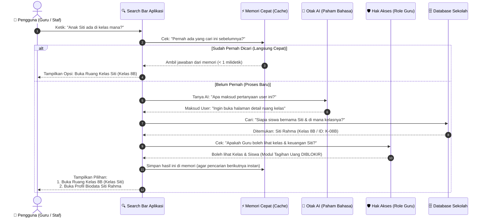
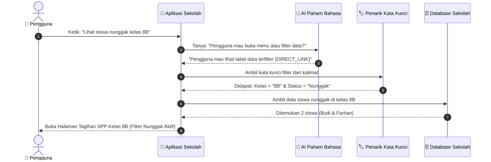
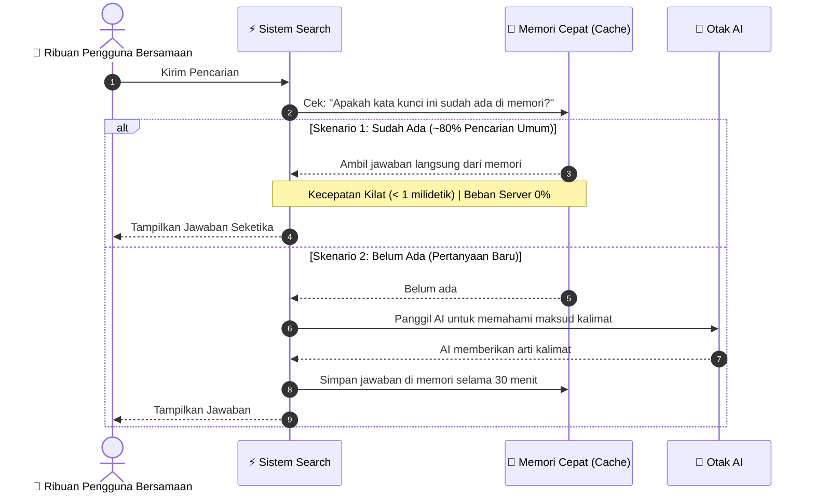
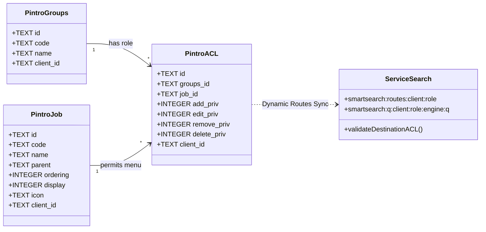
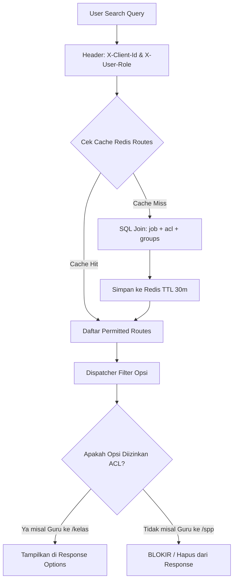
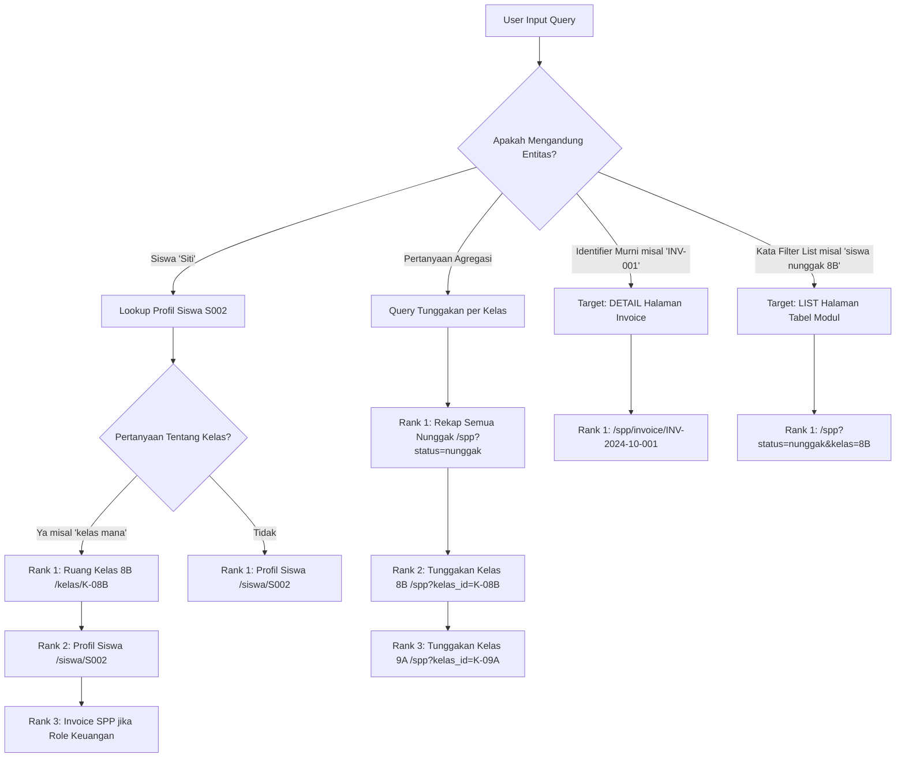

# Proof of Concept (POC): Smart Search System
### Domain: Sistem Manajemen Sekolah / Aplikasi Pendidikan
**Teknologi:** TypeSafe JEV (Cloud System One) & Laya (Local MLX Encoder) + SQLite Backend

---

## 1. Ringkasan Eksekutif & Objektif

Smart Search ini mengubah input bahasa alami (*natural language query*) dari pengguna sekolah (guru, tata usaha, orang tua) menjadi **aksi terstruktur (typed intents & parameters)** secara instan.

Terdapat 3 keluaran aksi:
1. **`LIST_MENU`**: Menampilkan navigasi kartu menu yang relevan.
2. **`DIRECT_LINK`**: Membuka halaman tabel/modul dengan filter parameter langsung terisi dan menjalankan query SQL ke database.
3. **`REPORT_ACTION`**: Menjalankan aksi cetak atau download file dokumen (misal buku rapor siswa).

Sistem ini mendukung arsitektur **Dual-Engine**:
- **Produksi (Primary)**: **TypeSafe JEV Cloud (`https://api.typesafe.ai/v1/systemone`)** — *Zero-Anchor*, model reasoning semantik terkalibrasi tanpa butuh dataset anchor contoh kalimat.
- **Lokal / Edge (Fallback / Prototyping)**: **Laya Local MLX Daemon (`http://127.0.0.1:4141`)** — Menggunakan embedding 768-dimensi MLX Apple Silicon dengan exemplar cosine similarity.

---

## 2. Arsitektur Sistem

```
                      [ User Input: Natural Language Query ]
                                        │
                                        ▼
                   ┌─────────────────────────────────────────┐
                   │       Smart Search Engine (:4000)       │
                   │  - Parameter Extractor (Regex / Entity) │
                   │  - Dual-Engine Classifier               │
                   └────────────────────┬────────────────────┘
                                        │
                 ┌──────────────────────┴──────────────────────┐
                 ▼                                             ▼
     [ TypeSafe JEV Cloud ]                        [ Laya Local MLX Daemon ]
   (https://api.typesafe.ai)                         (http://127.0.0.1:4141)
  - Zero-Anchor Semantic Criteria              - 768-dim Dense Embeddings
  - Native Calibrated Confidence               - Exemplar KNN + Softmax (T=0.05)
                 │                                             │
                 └──────────────────────┬──────────────────────┘
                                        │
                                        ▼
                   ┌─────────────────────────────────────────┐
                   │           Dispatcher Action             │
                   │  Transforms Intent + Slots into Action  │
                   └────────────────────┬────────────────────┘
                                        │
             ┌──────────────────────────┼──────────────────────────┐
             ▼                          ▼                          ▼
     [ LIST_MENU ]               [ DIRECT_LINK ]           [ REPORT_ACTION ]
  Daftar menu navigasi       URL deep link + filter       Aksi download / print
                                        │
                                        ▼
                   ┌─────────────────────────────────────────┐
                   │      App Pendidikan Backend (:3000)     │
                   │  SELECT id, ... FROM table WHERE filter │
                   │           [ SQLite Database ]           │
                   └─────────────────────────────────────────┘
```

### Sequence Diagram Alur Kerja Smart Search (Sederhana & Mudah Dipahami)

Diagram ini menjelaskan alur kerja dari sudut pandang interaksi nyata: **Pengguna mengetik ➔ Sistem memahami maksud ➔ Cek hak akses ➔ Ambil data ➔ Tampilkan opsi tindakan**.



---

## 3. Komparasi: TypeSafe JEV vs Laya MLX

| Dimensi | **TypeSafe JEV Cloud (System One)** | **Laya Local Daemon (MLX :4141)** |
|---|---|---|
| **Paradigma** | *Direct Semantic Choice via Criteria* | *Vector Embedding + Cosine Similarity* |
| **Kebutuhan Anchor** | **Zero-Anchor (TIDAK PERLU)** | **Wajib daftar kalimat anchor** (`anchors.json`) |
| **Maintenance** | Cukup deskripsikan maksud intent dalam teks singkat | Harus mengumpulkan dan memelihara variasi contoh kalimat |
| **Kecepatan (Latency)**| **~240ms – 320ms** (jaringan cloud) | **~10ms – 12ms** (in-memory warm cache lokal) |
| **Akurasi Benchmark** | **100%** pada 16 test case | **94%** pada 16 test case |
| **Deployment Target** | Cloud Production Backend | On-Premise / Edge / Offline Server |

### Mengapa JEV Tidak Membutuhkan Anchor?
Pada embedding tradisional (Laya), sistem menghitung jarak sudut vektor query ke kumpulan kalimat contoh (*anchors*). Jika variasinya belum terdaftar, akurasinya bisa menurun.

Sebaliknya, **TypeSafe JEV** menggunakan inferensi System One terarah. Developer cukup mendefinisikan kriteria logis:
```json
{
  "intent": {
    "type": "choice",
    "instructions": "Determine the user's intended smart search action in an education school management system.",
    "criteria": {
      "LIST_MENU": "User is looking for static navigation menus or settings (e.g. 'ke menu spp', 'menu profil').",
      "DIRECT_LINK": "User wants to view a specific filtered data table or deep link (e.g. 'lihat siswa nunggak kelas 8B', 'data nilai matematika').",
      "REPORT_ACTION": "User wants to generate, print, or download a report card / rapot document (e.g. 'cetak rapot kelas 8B', 'unduh rapot budi format pdf')."
    }
  }
}
```
JEV langsung melakukan probabilistic reasoning atas intent tanpa perlu menyimpan atau me-maintain database vektor kalimat.

---

## 4. Hasil Evaluasi Benchmark Head-to-Head

Hasil pengujian otomatis pada 16 query uji representatif bahasa Indonesia:

```text
=========================================================================
| Engine                  | Accuracy | Avg Latency | Latency Range      |
|-------------------------|----------|-------------|--------------------|
| TypeSafe JEV (Cloud)    | 100%     | 287.59 ms   | 237.87ms – 333.31ms|
| Laya-MLX (Local Daemon) | 94%      | 10.53 ms    | 9.88ms – 11.38ms   |
=========================================================================
```

---

## 5. Tiga Skenario & Integrasi SQLite

### Skenario 1: `LIST_MENU`
* **Query:** `"buka menu pembayaran spp"`
* **Intent:** `LIST_MENU` (Confidence: 100%)
* **Respon:**
```json
{
  "mode": "LIST_MENU",
  "matched_menus": [
    { "title": "Dashboard Utama", "path": "/dashboard" },
    { "title": "Pembayaran & Tagihan SPP", "path": "/spp" }
  ]
}
```

### Skenario 2: `DIRECT_LINK` + Eksekusi Query SQLite
* **Query:** `"lihat siswa nunggak kelas 8B"`
* **Intent:** `DIRECT_LINK` (Confidence: 84% - 100%)
* **Extracted Params:** `{ "kelas": "8B", "status": "nunggak" }`
* **Dispatched Target URL:** `/spp?status=nunggak&kelas=8B`
* **Eksekusi SQL di Backend (`app-education`):**
```sql
SELECT id, siswa_id, nama_siswa, kelas, bulan, nominal, status, jatuh_tempo 
FROM spp 
WHERE 1=1 AND LOWER(status) = LOWER('nunggak') AND LOWER(kelas) = LOWER('8B');
```
* **Hasil SQLite:** Mengembalikan 2 record siswa nunggak (*Budi Santoso* dan *Farhan Nugraha*).

### Skenario 3: `REPORT_ACTION`
* **Query:** `"cetak rapot kelas 8B semester ganjil"`
* **Intent:** `REPORT_ACTION` (Confidence: 100%)
* **Extracted Params:** `{ "kelas": "8B", "semester": "ganjil", "format": "print" }`
* **Respon:**
```json
{
  "mode": "REPORT_ACTION",
  "action": "PRINT_RAPOT",
  "title": "Cetak / Unduh Rapot (Kelas 8B Semester ganjil)",
  "download_url": "/api/rapot/download?kelas=8B&semester=ganjil&format=print"
}
```
* **Eksekusi Download:** `HTTP GET /api/rapot/download?kelas=8B&semester=ganjil&format=print` mengembalikan header `attachment; filename="Rapor_Semua_Siswa_Kelas_8B_ganjil.print"` beserta dokumen siap cetak.

---

## 6. Struktur Project & File

```
poc-smart-search/
├── docs/
│   └── POC_SMART_SEARCH.md          # Dokumen teknis POC ini
├── service-search/                  # Service Search Engine (Port 4000)
│   ├── src/
│   │   ├── classifier.ts            # Dual engine: JEV Cloud & Laya Local
│   │   ├── extractor.ts             # Regex entity parameter extraction
│   │   ├── dispatcher.ts            # Intent → Action transformer
│   │   ├── visualizer.ts            # Terminal interactive color visualizer
│   │   ├── server.ts                # HTTP Server (:4000/resolve)
│   │   ├── cli.ts                   # Interactive CLI Runner
│   │   ├── benchmark.ts             # Automated benchmark suite
│   │   └── anchors.json             # Anchors data (khusus Laya)
│   └── package.json
├── app-education/                   # App Aplikasi Pendidikan (Port 3000)
│   ├── src/
│   │   ├── data/
│   │   │   ├── db.ts                # SQLite schema & initialization
│   │   │   └── mock.ts              # Data definition types
│   │   └── server.ts                # REST API & Search Gateway (:3000/api/search)
│   ├── education.db                 # Database SQLite lokal
│   └── package.json
├── test-e2e.ts                      # Test integrasi E2E end-to-end
├── run-test.ts                      # Automasi start-and-test runner
└── package.json                     # Root scripts runner
```

---

## 7. Panduan Menjalankan

### Persyaratan
- Node.js v20+ atau Bun 1.1+
- API Key TypeSafe tersedia di environment variable: `export TYPESAFE_API_KEY="your-key"`
- *(Opsional)* Laya daemon running di `http://127.0.0.1:4141` jika ingin menguji engine lokal.

### 1. Interactive CLI (Visualisasi Realtime)
```bash
bun run cli
```
Fitur CLI:
- Ketik `:jev` untuk memaksa JEV Cloud.
- Ketik `:laya` untuk memaksa Laya Local MLX.
- Ketik `:auto` untuk deteksi otomatis.
- Ketik query apapun dan lihat breakdown probabilitas secara langsung.

### 2. Menjalankan Benchmark Head-to-Head
```bash
bun run test:benchmark
```

### 3. Menjalankan Tes E2E (Full Integration Test)
```bash
bun run test:e2e
```

### 4. Menjalankan Server Mandiri
**Terminal 1:**
```bash
bun run start:search
```
**Terminal 2:**
```bash
bun run start:app
```
**Akses API:**
```bash
# Gateway Smart Search
curl "http://127.0.0.1:3000/api/search?q=lihat%20siswa%20nunggak%20kelas%208B&engine=jev"
```

---

## 8. Tracing Alur Eksekusi Kode: Dari Input ke Tindakan

Diagram alur berikut menjelaskan bagaimana sistem memproses pencarian terfilter seperti *"lihat siswa nunggak kelas 8B"*:



---

## 9. Skalabilitas Tinggi: Memori Cepat (Cache) Menahan Ribuan User

Untuk mendukung **ribuan pengguna mencari secara bersamaan**, sistem memakai memori cepat (Cache) agar server tidak berat dan tidak bolak-balik memanggil AI:



### 1. Dynamic Route Manifest Sync (Zero-Hardcoded Routes)
* **Single Source of Truth**: Route aplikasi didaftarkan di `app-education` (`GET /api/routes`).
* **Auto-Sync ke Redis**: `service-search` men-sync manifest ini ke Redis dengan key `smartsearch:routes:manifest` (TTL 30 menit).
* **Zero Hardcoded**: Kode search engine tidak menyimpan path URL statis. Jika tim frontend/backend menambah halaman baru di `app-education`, search engine langsung mengenalnya tanpa perlu deploy ulang.

### 2. Query Result Cache
* Key: `smartsearch:q:<engine>:<normalized_query>`
* Hit pertama: query diproses via JEV Cloud (~280ms).
* Hit berikutnya (dari user manapun dalam 30 menit): dijawab langsung dari RAM Redis dalam waktu **< 1ms**, menghemat 100% beban CPU AI.

---

## 10. Integrasi Skema Nyata Pintro: Multi-Tenant (`client_id`) & Role ACL (`job`, `groups`, `acl`)

Sistem mengadopsi skema database nyata Pintro untuk otorisasi menu dan isolasi tenant:



### Flowchart Evaluasi Hak Akses ACL Menu:



### Tabel Relasi Pintro yang Digunakan:
1. **`pintro.job`**: Menyimpan daftar modul/menu (`id`, `code`, `name`, `parent`, `ordering`, `display`, `icon`, `client_id`).
2. **`pintro.groups`**: Menyimpan master role (`id`, `code`, `name`, `client_id`) seperti `SUPERADMIN`, `GURU`, `KEUANGAN`, `SISWA`.
3. **`pintro.acl`**: Hak akses relasi group ke job (`groups_id`, `job_id`, `add_priv`, `edit_priv`, `delete_priv`, `client_id`).

### Proteksi Keamanan Hasil Pencarian:
* **Role GURU**: Memiliki akses ke `DASHBOARD`, `SISWA`, `NILAI`, `RAPOT`. Ketika mencari `"lihat siswa nunggak"`, sistem **menolak memberikan link ke `/spp`** (karena tidak ada di ACL) dan secara cerdas mengalihkannya aman ke `/siswa`.
* **Role KEUANGAN**: Memiliki akses ke `DASHBOARD`, `SISWA`, `SPP`. Ketika mencari `"cetak rapot"`, sistem **menolak aksi `PRINT_RAPOT`** dan menurunkannya menjadi `LIST_MENU` biasa.
* **Isolasi Redis**: Cache search query di-tag menggunakan `client_id` dan `role` (`smartsearch:q:1:GURU:jev:...`), menjamin tidak terjadi kebocoran cache antar sekolah maupun antar peran pengguna.

---

## 11. Entity Master Resolver, Multi-Option Array & Threshold Matching

Sistem mengadopsi format standardized response berbentuk array `options[]` dengan pembeda target `DETAIL` vs `LIST`:



### Contoh Kontrak Standardized JSON Array Output:

```json
{
  "status": "success",
  "query": "kelas 8B",
  "client_id": "1",
  "user_role": "KEUANGAN",
  "engine": "JEV_CLOUD",
  "threshold": 0.2,
  "total_options": 2,
  "options": [
    {
      "rank": 1,
      "score": 0.88,
      "intent": "DIRECT_LINK",
      "target_type": "DETAIL",
      "title": "Detail Kelas 8B",
      "description": "Buka halaman informasi dan daftar siswa Kelas 8B",
      "destination": "/kelas/K-08B",
      "entity": {
        "type": "kelas",
        "id": "K-08B",
        "code": "8b",
        "name": "Kelas 8B"
      }
    },
    {
      "rank": 2,
      "score": 0.79,
      "intent": "DIRECT_LINK",
      "target_type": "LIST",
      "title": "Tagihan SPP - Kelas 8B",
      "description": "Buka tabel tagihan SPP untuk Kelas 8B",
      "destination": "/spp?kelas_id=K-08B",
      "entity": {
        "type": "kelas",
        "id": "K-08B",
        "code": "8b",
        "name": "Kelas 8B"
      }
    }
  ]
}
```

### Komponen Utama:
1. **Lowercase Job Code & Clean Paths**:
   - `job.code` di database memakai huruf kecil (`spp`, `siswa`, `nilai`, `rapot`, `dashboard`, `kelas`).
   - Path tujuan murni diturunkan dari `/${j.code}` tanpa ketergantungan mapping hardcoded.
2. **Entity Resolver Endpoint (`GET /api/master/resolve?q=...`)**:
   - Mengekstrak identifier spesifik: Ruang Kelas (`K-08B`), Invoice Tagihan (`INV-2024-10-001`), dan Siswa (`S001`) dengan query parameterized `WHERE client_id = ?`.
3. **Pembeda `DETAIL` vs `LIST`**:
   - `DETAIL`: Mengarahkan langsung ke halaman entitas (cth: `/kelas/K-08B` atau `/spp/invoice/INV-...`).
   - `LIST`: Mengarahkan ke tabel fitur terfilter (cth: `/spp?kelas_id=K-08B&status=nunggak`).
4. **Dynamic Threshold**:
   - Query param `threshold` (default `0.20` atau 20%).
   - Hanya opsi dengan probabilitas/skor di atas threshold yang masuk ke array `options[]` terurut menurut rank.

### 5. Penanganan Pertanyaan Alami Manusia & Relasi Entitas Otomatis:

Sistem telah diuji dan dilengkapi pemahaman pertanyaan bisnis bahasa manusia:

#### A. Pertanyaan Relasi: *"Aku ingin tahu nama anak siti ada di kelas mana"*
* **Pemecahan Masalah**:
  1. JEV/Laya mengenali intent `DIRECT_LINK`.
  2. Smart Resolver mengekstrak nama **"Siti"** ➔ menemukan siswi **Siti Rahma** (NISN `0081234562`, Kelas `8B`, Kelas ID `K-08B`).
  3. Sistem mendeteksi kata tanya **"di kelas mana"** ➔ **Ruang Kelas 8B dinaikkan ke Rank #1**.
* **Proteksi ACL Berdasarkan Role**:
  - Jika yang mencari adalah **Role `GURU`**:
    - Hanya menghasilkan 2 opsi legal: Ruang Kelas 8B (`/kelas/K-08B`) & Profil Siswa (`/siswa/S002`). Opsi SPP/Tagihan **otomatis diblokir** karena Guru tidak memiliki izin modul keuangan.
  - Jika yang mencari adalah **Role `KEUANGAN`**:
    - Menghasilkan 3 opsi lengkap termasuk tagihan SPP (`/spp/invoice/INV-2024-10-002`).

#### B. Pertanyaan Agregasi: *"Kelas mana saja yang telat bayar?"*
* **Pemecahan Masalah**:
  1. JEV/Laya mengenali domain keuangan SPP.
  2. Resolver mendeteksi kata tanya agregasi (*"kelas mana saja yang telat/nunggak"*).
  3. Database mengeksekusi kalkulasi tunggakan nyata per kelas:
     ```sql
     SELECT k.id, k.name, COUNT(s.id) as total_nunggak, SUM(s.nominal) as total_nominal
     FROM spp s JOIN master_kelas k ON LOWER(k.code) = LOWER(s.kelas)
     WHERE s.client_id = ? AND s.status = 'nunggak'
     GROUP BY k.id, k.name;
     ```
  4. Dispatcher mengembalikan multi-opsi:
     - **Rank #1**: `Rekap Tunggakan SPP per Kelas` ➔ `/spp?status=nunggak`
     - **Rank #2**: `Daftar Tunggakan Kelas 8B (2 Siswa - Total Rp 1.000.000)` ➔ `/spp?status=nunggak&kelas_id=K-08B`
     - **Rank #3**: `Daftar Tunggakan Kelas 9A (1 Siswa - Total Rp 550.000)` ➔ `/spp?status=nunggak&kelas_id=K-09A`

---

## 12. Kesimpulan & Rekomendasi Produksi

1. **Gunakan TypeSafe JEV untuk Produksi:**
   - Menghilangkan beban pengelolaan dan pelabelan *anchor sentences*.
   - Akurasi pemahaman konteks bahasa Indonesia sangat tinggi (100% pada benchmark).
   - Skema output berbasis kriteria mempermudah penambahan modul baru di masa depan tanpa retrain model.

2. **Laya MLX Sebagai Edge / Offline Backup:**
   - Latensi super cepat (~10ms) cocok untuk *high-frequency instant search* atau deployment sekolah tanpa koneksi internet stabil.
